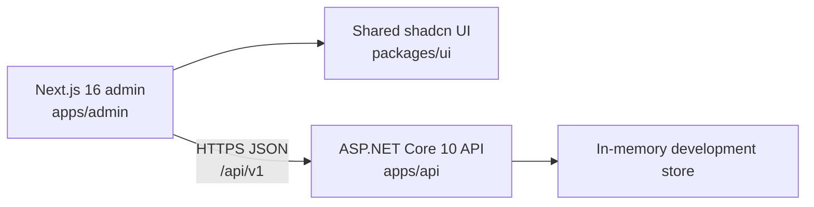

# Ledgerly ERP

Ledgerly is a full-stack ERP starter for small and growing operations teams. It pairs a focused Next.js admin workspace with a typed ASP.NET Core API for customer records, inventory control, and sales-order workflows.

The project is deliberately structured to show production-minded C# practices: clear endpoint groups, request and response contracts, correlation IDs, validation-friendly Problem Details responses, rate limiting, and replaceable infrastructure.

## What is included

| Area | What it supports |
| --- | --- |
| Dashboard | Operational metrics, cash-flow snapshot, activity, invoices, and alerts |
| Customers | Paginated customer directory and customer creation |
| Inventory | Warehouse-aware stock list, low-stock indicators, and idempotent adjustments |
| Sales orders | Draft creation, confirmation, customer selection, and stock-item selection |
| Shared UI | shadcn/ui `Button`, `Card`, `Badge`, and `Table` components with Geist typography |
| API quality | Request correlation, CORS, rate limits, pagination metadata, and RFC 7807-style errors |

## Architecture



The frontend calls the API directly from the browser. Set `NEXT_PUBLIC_API_BASE_URL` when the API is not served from `http://localhost:5049`.

## Tech stack

- Next.js 16, React 19, TypeScript, and Tailwind CSS 4
- shadcn/ui with the Base Nova style and shared workspace components
- Geist and Geist Mono through `next/font`
- .NET 10 minimal APIs and C# domain/application layers
- pnpm workspaces and Turborepo

## Repository layout

```text
apps/
  admin/                 Next.js operations workspace
    app/                 Dashboard and ERP module routes
    components/          Workspace shell and UI state components
    lib/                 Browser API client
  api/                   ASP.NET Core 10 API
    Application/         Use-case services and result handling
    Contracts/           Request and response DTOs
    Domain/              ERP entities and value objects
    Endpoints/           Versioned minimal API route groups
    Infrastructure/      In-memory development store
    Middleware/          Correlation-ID middleware
packages/
  ui/                    Shared shadcn components and theme tokens
```

## Prerequisites

- Node.js 20.9 or later
- pnpm 11.25 or later
- .NET 10 SDK

## Run locally

Install JavaScript dependencies and restore the API once:

```powershell
pnpm install
dotnet restore apps/api/AdminErp.Api.csproj
```

Start the API in one terminal:

```powershell
dotnet run --project apps/api/AdminErp.Api.csproj
```

The API listens on `http://localhost:5049` and `https://localhost:7049` in development.

Start the admin workspace in a second terminal:

```powershell
pnpm --filter admin dev
```

Open [http://localhost:3000](http://localhost:3000). The admin defaults to `http://localhost:5049` for its API.

### Frontend API configuration

Create `apps/admin/.env.local` when the API runs elsewhere:

```dotenv
NEXT_PUBLIC_API_BASE_URL=https://api.example.com
```

Restart the Next.js dev server after changing a `NEXT_PUBLIC_` variable.

### Check the API

```powershell
Invoke-RestMethod http://localhost:5049/health
```

If port `5049` is already occupied, identify its listener before stopping it:

```powershell
Get-NetTCPConnection -LocalPort 5049 -State Listen
Stop-Process -Id <PID>
```

## API reference

The API is versioned under `/api/v1`. List endpoints return `{ data, meta }`, where `meta` contains page information. Single-resource and dashboard responses include correlation metadata when applicable.

| Method | Endpoint | Purpose |
| --- | --- | --- |
| `GET` | `/health` | Health check |
| `GET` | `/api/v1/dashboard` | Dashboard overview |
| `GET` | `/api/v1/customers?page=1&pageSize=25&q=` | List or search customers |
| `GET` | `/api/v1/customers/{id}` | Get one customer |
| `POST` | `/api/v1/customers` | Create a customer |
| `GET` | `/api/v1/inventory/items?page=1&pageSize=25&q=&warehouse=` | List or filter inventory |
| `POST` | `/api/v1/inventory/items/{id}/adjustments` | Apply a stock adjustment |
| `GET` | `/api/v1/sales-orders?page=1&pageSize=25` | List sales orders |
| `GET` | `/api/v1/sales-orders/{id}` | Get one sales order |
| `POST` | `/api/v1/sales-orders` | Create a draft sales order |
| `POST` | `/api/v1/sales-orders/{id}/confirm` | Confirm a draft order |

Use [`apps/api/AdminErp.Api.http`](apps/api/AdminErp.Api.http) with a compatible REST Client to exercise the seeded development API, including validation and idempotency examples.

### API conventions

- Send `X-Request-Id` to supply a correlation ID; the API returns it on the response.
- Pagination is one-based. `pageSize` accepts values from 1 through 100.
- The API has a fixed-window limit of 120 requests per minute.
- Inventory adjustment `reference` values are idempotency keys. Reusing one is rejected.
- Validation, conflicts, and missing resources use Problem Details responses.

## Development commands

```powershell
# Frontend type safety
pnpm --filter admin typecheck

# Frontend production build
pnpm --filter admin build

# API compile check
dotnet build apps/api/AdminErp.Api.csproj
```

## Deployment

Deploy the Next.js admin independently from the API.

1. Deploy `apps/admin` to Vercel or another Node-capable frontend host.
2. Deploy `apps/api` to a .NET-capable host such as Azure App Service, Azure Container Apps, Render, Railway, or a container platform.
3. Set `NEXT_PUBLIC_API_BASE_URL` in the frontend deployment to the public API URL.
4. Add the frontend origin to `Cors:AllowedOrigins` in the API configuration.

Vercel is a good fit for the Next.js admin, but it does not run this persistent ASP.NET Core API as part of the same deployment.

## Current persistence model

The development API uses an in-memory store with seeded customers and inventory. It is intentionally isolated behind application services so it can be replaced by EF Core and a durable database. Data created during a local session resets when the API restarts.

## Next steps

- Replace the in-memory store with EF Core and a relational database.
- Add authentication, authorization, tenant isolation, and audit persistence.
- Implement purchase, accounting, reporting, and settings modules.
- Add API integration tests and end-to-end UI tests.
